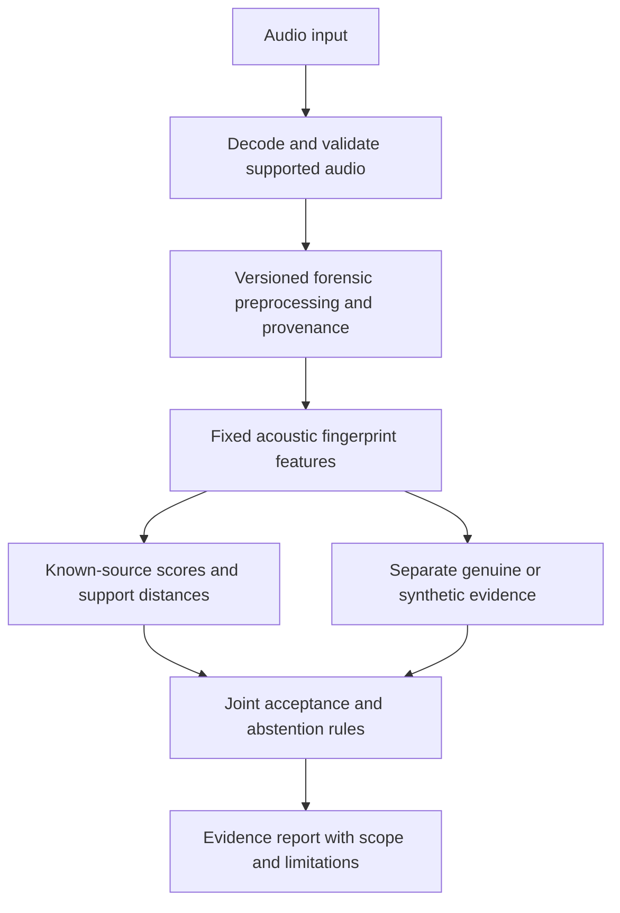

# VocoTrace feasibility review — Phase 4A

2026-11-05. Review HEAD: `f2f7b3819fd9bf449374e1699be635185a1441fc`.
**Development-only, non-citable.** This review fits no research model, changes
no dataset, and performs no new frozen-eval scoring or tuning. Published work
is cited as external evidence, not as a reproduced project result.

**Recommend option C:** make whole-audio, known-source evidence and selective
attribution the primary capability; retain VocoPatch as a controlled robustness
test resource. Stop optimizing the current localizer. Do not yet describe the
system as robust, open-world, or capable of certifying genuine speech.

The pilot establishes promising **closed-set processing-chain separability**
on one legacy speaker/corpus. It does not establish generator-independent
deepfake detection or reliable unknown rejection. A useful next milestone is
a small, leakage-checked robustness/abstention evaluation harness using existing
features and lightweight reference heads, before a new representation or app.

## 1. Audit scope and evidence status

Read AGENTS.md, the binding invariant rules in CLAUDE.md, the forensic pilot and
measurements documentation, Phase 2 generation/protocol documentation and the
Phase 3A–3E reports. Inspected the actual feature, fit, bundle, inference,
attribution-scaffold and evaluation code rather than treating planning prose
as implemented functionality.

Primary historical artifact roots:

- `runs/forensic-pilot-step3-20261012/v0-final/`
- `runs/forensic-pilot-step3-20261012/v0-final-evaluation/`
- `runs/forensic-pilot-step3-20261012/v0-smoke/`

New review receipts/scripts are only in
`runs/vocotrace-phase4a-audit-20261105/`. The reproducible audit script
`verify_pilot.py` refuses any logistic `.fit()` call and traps access to the
`eval` member of the saved feature NPZ.

Three kinds of evidence must remain distinct:

1. **Historical eval aggregates:** read the already reported metrics, verify
   their saved inventories and identical previous evaluation copy, and reproduce
   confusion-matrix arithmetic. No eval WAV, eval feature array, or individual
   eval prediction row is analyzed. The prediction CSV is checked as opaque
   bytes; its schema is inspected from the header only.
2. **Current train/dev verification:** reproduce saved scaler statistics from
   the 640-row `train_dev` array, verify all 640 train/dev source audio hashes,
   replay one complete training comparison group's feature extraction and
   score frozen heads on saved dev features. No refit or new model selection.
3. **Proposals:** open-set, transformation and application designs below are
   unexecuted. There are no newly measured robustness or unknown-source results.

Do not run the existing `pilot evaluate` or `load_pilot_dataset` as a review
shortcut: the former scores eval, and the latter hashes all archive WAVs,
including eval. This review uses sanctioned manifest resolution and metadata
validation, then explicitly limits audio access to train/dev.

## 2. Verified attribution pilot

### Representation and training

The representation is **fixed acoustic statistics**, not a learned embedding:

- Mono PCM16 WAV, 22,050 Hz, supported duration 0.1–60 s. Unsupported rates,
  channels or encoding are rejected rather than implicitly converted.
- Existing common zero-phase Chebyshev-II below-8-kHz comparison transform on
  real and every vocoder, with band verification. Temporary analysis WAVs are
  written as PCM16 and reread through sanctioned I/O before feature extraction.
- First 89,027 samples (approximately 4.0375 s), repeat-padding short inputs.
  A first-crop prediction is not analysis of an entire longer upload.
- Uncentered 1,024-sample periodic Hann frames, hop 256. Mean power in 32
  linear-frequency bands in [0, 8,000) Hz, `log10(max(power, 1e-12))`, then
  32 frame means and 32 population standard deviations: 64 float64 features.
- Independent StandardScaler/L2 logistic heads: binary C=0.01, attribution C=10,
  selected historically from {0.01, 0.1, 1, 10} using dev only. No dev refit.
  Attribution uses only synthetic training rows and three ordered classes:
  BigVGAN-112m, Griffin-Lim, Vocos.

The original frozen source partition is **140 train / 20 dev / 40 eval**,
with four archive conditions per source. That is 560 / 80 / 160 recordings,
not that many independent utterances. All conditions of an utterance share
its split; real is not duplicated per vocoder. The loader checks complete
groups, paired lengths, duplicate paths/recordings and cross-split byte copies;
multiple speakers would require speaker-disjoint splits. Those checks do not
prove absence of near-duplicate content or upstream vocoder training exposure.

Current numerical verification finds **exact mean and scale equality** for
the binary scaler fitted on 560 training rows and the attribution scaler fitted
on 420 synthetic training rows. Real/dev/eval rows do not enter attribution
normalization. Binary balanced weights are real=2, synthetic=2/3; attribution
has 140 rows per class with no additional class weighting. Standardization is
unweighted, as implemented originally.

One complete four-condition training group, `LJ001-0069`, reproduces its saved
64-dimensional features exactly through current sanctioned preprocessing.
Current bundle loading passes dependency, preprocessing-source, shape, mapping
and checksum checks. No claim of a new full optimizer replay is made.

### Historical eval results: checked, not newly rescored

The figures in the Phase 4A request refer to the pilot's **historical 40-source
eval cohort**, not the 17-source VocoPatch dev set. They remain development-only
despite the split name. This cohort was already scored/reviewed; preserving its
assignment does not make it a pristine final research holdout.

| Saved historical metric | Value | Verification in this review |
|---|---:|---|
| Binary AUROC | 0.6791666667 | Identical saved metric copies and valid inventories; not recomputed from eval scores |
| Binary directional EER | 0.3833333333 | Same scope; corrected-EER implementation is used by the pilot |
| Standalone attribution macro-F1 | 0.8826733710 | Recalculated from saved aggregate confusion matrix |
| Synthetic routing recall | 80/120 = 0.6666666667 | Recalculated from saved binary matrix |
| Correctly detected **and** attributed / all true synthetic | 0.5833333333 | Existing saved joint result; 70/120, not independently recoverable from the two marginal matrices alone |
| Real incorrectly routed synthetic | 18/40 = 0.45 | Saved FRR / binary matrix; current cascade then assigns a known source |

Attribution matrix, rows=true and columns=predicted, order
`[bigvgan_112m, griffin_lim, vocos]`:

```
              predicted
              BigVGAN  Griffin-Lim  Vocos
BigVGAN          36        0          4
Griffin-Lim       0       40          0
Vocos            10        0         30
```

| True class | Precision | Recall | F1 | Support |
|---|---:|---:|---:|---:|
| BigVGAN-112m | 36/46 = 0.782609 | 36/40 = 0.900000 | 0.837209 | 40 |
| Griffin-Lim | 1.000000 | 1.000000 | 1.000000 | 40 |
| Vocos | 30/34 = 0.882353 | 30/40 = 0.750000 | 0.810811 | 40 |

For each class, `F1 = 2 TP / (row_total + column_total)`; the unweighted mean
is `(72/86 + 1 + 60/74)/3 = 0.8826733710`. It is not binary detection F1,
unknown rejection performance, or an all-upload attribution accuracy.

The binary matrix, ordered `[synthetic, real]`, is `[[80,40],[18,22]]`.
The dev-selected boundary is `0.07470214195092881`, with **higher scores meaning
real** and the strict rule `score > boundary`. Historical eval FAR is 40/120,
FRR is 18/40. The EER crossing boundary is a different quantity and is not used
as this operating point. Saved per-vocoder binary EERs are 0.450 / 0.200 / 0.425.
These remain historical aggregates; no new per-vocoder eval analysis is performed.

Standalone attribution intentionally evaluates **every true synthetic input**,
including 40 that the binary detector calls real. The deployed pilot interface
first routes with the binary head, then assigns an argmax known class to every
synthetic-routed input. It has no unknown/abstain class, so the 0.8827 result
cannot describe that interface's reliability on arbitrary uploads. The existing
joint 0.5833 result must not be replaced by multiplying marginal recalls/F1s.
The old score/logit outputs are explicitly uncalibrated.

### Current replay on already selected dev data

From the saved 640-row train/dev array, without fitting:

| Frozen selected head | Replayed dev metric | Saved selection value |
|---|---:|---:|
| Binary C=0.01 | AUROC 0.7016666667; EER 0.300000 | Same |
| Attribution C=10 | Macro-F1 0.8832603711 on 60 true synthetic rows | Same |
| Binary operating rule | Boundary 0.07470214195092881; balanced error 0.2916666667 | Same |

These 20 sources participated in C/threshold selection; these are consistency
checks, not independent validation. The four candidate fits are not repeated
because new fitting is outside this review. All 80 single-feature inference
results agree with the numerical heads and routing, with score agreement to
1e-12. The original boundary reproduces exactly.

### Metadata leakage and provenance

Paths, condition names, speaker, split, source labels, file length and header
metadata are not feature columns. They validate/select rows and attach results.
The single-file path places the unknown waveform in the comparison API's
reference slot; the filter is independent per waveform and does not consult a
real reference recording. Existing tests cover grouped/single-file feature
equality, renaming independence, train-only normalization, numeric inference
and freezing before the historical eval extraction. Source metadata in output
tables is not an inference input. Acoustic shortcuts remain possible.

Verified model digest:
`e12b94dd4aa5f375968cc7180feda42294fe8d7f184fd692e6c4c1507ce8eb76`.
The final and earlier smoke numeric model files still have the same digest.
All 9 final, 2 separate-evaluation and 9 smoke non-receipt artifact hashes match
their inventories; final/separate-evaluation metrics bytes and prediction CSV
digests agree. Dataset identity agrees across bundle and receipt; the current
manifest and canonical frozen group map match their saved digests. All 640
train/dev WAV hashes match the recorded feature-row identities.

The saved all-archive audio aggregate includes eval and is **not refreshed**
here. Eval-containing NPZ/CSV artifacts are hashed only as opaque stored bytes.
The NPZ's `eval` array is never materialized. No fresh whole-dataset byte audit
is claimed. Hashes establish consistency, not authenticity, source rights or
proof of correct generation. Historical code HEAD `825bbfd79dbd16321fc46639c5193c8201c4efc8`
and working-tree digests identify that exploratory run; later manual commits do
not retroactively turn it into valid record-mode evidence.

## 3. Scientific feasibility and confounds

| Question | What existing evidence supports | What is missing |
|---|---|---|
| Is there a learnable label association? | High three-way whole-audio attribution on held source IDs within one corpus | Causal isolation of a stable generator fingerprint |
| Is binary detection already reliable? | Above-chance historical ranking | Low-risk operating point; unknown/domain coverage; genuine false-attribution control |
| Is the high-band cliff directly used? | Pilot only uses bins below 8 kHz after common filtering/PCM16 verification | Proof that all legacy low-band processing/history is correct |
| Does it generalize across speakers/content? | Same utterance pairing controls content across classes; split IDs differ | New speakers, languages, corpora, channels and independent upstream-training provenance |
| Does it identify an architecture/family? | It separates three specific source pipelines/checkpoints | Multiple checkpoints/configurations per architecture; controlled architecture/family experiments |
| Is it robust or open-set? | No such measurement in the pilot | Matched transformations, known/unknown separation and calibrated abstention |

The primary band removes direct use of the known Griffin-Lim above-8-kHz absence
and Vocos high-band resampling edge. This is a valuable control, not proof of
confound freedom. Committed measurements document that the torchaudio-default
round trip can remain separable **below** the band, whereas the pinned Kaiser
control behaves differently. Legacy generation records do not establish which
history produced every v0 byte. Do not infer that the current resampler pin was
used merely because it is now configured.

Different native mel front ends, sample rates, phase reconstruction, envelope/
noise behavior, historical loudness/trim decisions and in-band filtering can
all become learned associations. Perfect Griffin-Lim classification does not
identify which cue was used. Fixed spectral means/stds discard most temporal
structure and can emphasize overall spectral shape. Existing scalar probes and
metadata exclusions do not certify robustness to unseen processing.

Single-speaker pairing prevents a simple between-class speaker-label shortcut
inside this dataset, but does not establish speaker independence. Repeat-padding,
first-crop content and recording/channel characteristics may interact with the
class signal. Byte-copy checks do not detect every near-duplicate utterance or
overlap with upstream vocoder training data.

Phase 3B found most localizer false positives well away from boundaries; Phase
3C's small CNN and Phase 3D nuisance controls failed to recover useful localization.
Phase 3E retained the original model after 25/50% paired-negative weighting
failed its predeclared train-OOF objective. These findings support a change of
engineering priority, not a proof that stronger representations cannot work.
The partial 870 recordings represent **174 sources**, with only 123/17 eligible
train/dev groups, and fixed one-second edits. They are not 870 independent
speaker/generator examples. Donor eligibility exclusions create selection bias.

No quality-axis, high-band attribution or architecture-generalization research
claim is established. INV-17/18 band membership remains binding: the measured
Griffin-Lim/Vocos high-band exclusions are not waived for a new product name.
Legacy provenance, current gate revalidation and the existing one-sided probe
orientation limitation remain separate admission blockers.

### Prior art and novelty boundary

Fingerprint/source attribution is already an established research direction.
[Zhang et al., v2](https://arxiv.org/abs/2309.06780v2) study acoustic-model and vocoder
fingerprints using multi-speaker data. [Pizarro et al., v4](https://arxiv.org/abs/2411.14013v4)
describe residual fingerprints for closed/open-world attribution and detection,
including distance-based out-of-domain handling. These publications motivate
reference reproduction; they do not validate this pilot or transfer their scores.

[STOPA, v3](https://arxiv.org/abs/2505.19644v3) describes systematic variation of
acoustic models, vocoders and weights for source tracing. It is a candidate for
a separate suitability/provenance/license audit, not an acquired or admitted
project dataset. No files or models were downloaded here.

Novelty potential lies in controlled paired evidence, transformation/partial
mixture stress tests, confound-aware interpretation and honestly measured
selective performance. A renamed three-way classifier, a distance threshold,
or a confidence-colored UI would not by themselves be a new research method.
The linked primary sources were checked on 2026-11-05, with arXiv versions
explicit above. This is a targeted check, not an exhaustive literature review.

## 4. Feasible open-set protocol

### Targets and decisions

Separate these tasks: (a) known-source discrimination on true synthetic inputs,
(b) detecting synthetic evidence versus genuine speech, (c) rejecting unsupported
source claims, and (d) complete recording-level decisions. Failure to match a
known vocoder is not evidence that speech is genuine. An unknown source may be
a new vocoder, checkpoint, TTS/VC pipeline, codec/channel, or ordinary domain shift;
the model cannot identify the cause from a rejection score alone.

For a first controlled baseline, retain the fixed 64-feature descriptor and
compare a closed-set logistic reference with **one** class-support rejector:
train-only standardized class centroids and pooled shrinkage covariance, with
distance to the predicted source. Fit means/covariance only on permitted
known-source training rows. Predeclare shrinkage, score direction, tie handling,
class mapping and a threshold-calibration rule before scoring held-out sources.
Do not create a broad rejection-method search on the three available classes.

Calibrate distance cutoffs on source-disjoint **known-only** calibration groups,
using all true-known calibration observations for each class rather than silently
dropping misclassified cases. Fit any temperature on separate known-class
calibration logits/NLL only; report reliability, Brier/NLL and accepted error/
coverage, not just a nominal percentage. With this small dataset prefer a simple
pooled calibration rule and report support counts rather than many fitted
class-specific parameters. [Temperature calibration](https://proceedings.mlr.press/v70/guo17a.html)
is a candidate for known-class probabilities, not a guarantee for unknown inputs.

Report how the distance and classifier labels interact: an LR candidate whose
support distance is too large is inconclusive, even if its softmax is high.
Known-class coverage and genuine false-known attribution are joint engineering
constraints. A proposed initial **5% genuine false-known-match target** is an
operating objective, not a change to a scientific gate. If genuine controls
and known coverage cannot satisfy the predeclared objective together, report
failure/abstention rather than moving a threshold after seeing test labels.
Known-only calibration can control observed known rejection; it cannot certify
unknown acceptance risk without independent unknown evidence.

### Leave one vocoder out, with source groups still frozen

Local feasibility: exactly three exploratory trials, each with two known classes
and one withheld vocoder. **A fresh two-class head/scaler is required.** The
existing three-class bundle has already seen all three sources; removing a logit
or calling one of its classes unknown is not leave-one-vocoder-out.

1. Use the original 140 training source groups. Predeclare and record
   deterministic grouped outer folds wholly within train; keep every condition, crop,
   transformation and control of a source in the same fold. Do not change the
   frozen 140/20/40 assignment or move a speaker between partitions. The old
   partial-audio fold table covers only 123 sources, so it cannot silently stand
   in for coverage of all 140. Use the existing fold utility on the declared
   whole-audio population and let partial descendants inherit those memberships
   for this new protocol; this does not reassign any frozen train/dev/eval group.
2. For held-out vocoder U, exclude U from **all** fits and calibration, including
   scaler/covariance estimation, binary synthetic training, feature selection,
   stopping and temperature/cutoff selection. This applies even to U's files
   from the outer fit sources. Inner grouped fit/calibration uses only the two
   known vocoders and genuine speech as appropriate.
3. Score known/genuine and U examples only on outer-held source groups after
   each fold is locked. U is a class withheld from a new system, not a new
   generator discovered in the world. All trial definitions and methods must
   be fixed before inspecting any U results. Do not use performance across the
   three U trials to tune and then call those same trials untouched tests.
4. Keep the 20-source dev cohort explicitly exposed. Use it once as a locked
   descriptive benchmark if later authorized; do not refit on it. Keep the
   existing eval cohort isolated. This review runs none of these trials.

With only three vocoders, nested unknown-class tuning is severely constrained:
withholding a second class for unknown calibration leaves only one known class.
If outlier exposure or unknown-informed tuning is desired, acquire distinct
calibration generators and reserve different final unknown generators under
a separately approved protocol. Do not use the eventual held-out generator as
an unknown threshold example. Blocked or nonexistent ladder outputs are not
extra unknown data, and failed alignment conditions must not be admitted.

Two-class trials may primarily separate Griffin-Lim's reconstruction behavior,
BigVGAN's GAN pipeline and Vocos's front-end/processing chain. Three trials are
not three independent replications of general open-world recognition. Checkpoint,
architecture, speaker and channel shifts require distinct tests. No current
dataset provides a credible broad unknown-generator final evaluation.

### Metrics and uncertainty

Report separately by withheld source, known class, transformation and source group:

- Closed-set known-only macro-F1/confusion and per-class precision/recall.
- Unknown rejection recall and unknown false-known acceptance; known acceptance
  coverage and accepted-label precision/accuracy. Include the reject-all endpoint.
- Genuine false-known attribution and binary false alarm/miss rates; known-source
  assignment must be scored on genuine inputs too, not only oracle synthetic rows.
- Known/unknown score AUROC and OSCR or a clearly defined risk/coverage curve,
  alongside **locked operating points**. Threshold-independent curves are
  evaluation summaries, not permission to choose a test threshold.
- End-to-end correctly detected-and-attributed fraction over all true synthetic
  recordings, plus an explicit inconclusive outcome in the recording-level matrix.

Bootstrap source utterances with all their variants/transformations together;
never resample windows as independent trials. Multi-speaker work additionally
needs speaker-aware evaluation/uncertainty. State whether intervals condition
on fixed fitted scores or repeat fitting/selection. Do not attach newly computed
eval uncertainty to the old pilot in this review. Even zero errors among 20
independent genuine observations has a one-sided 95% binomial upper bound of
`1 - 0.05^(1/20) = 13.91%`; small dev counts cannot certify a 5% future error rate.
That calculation is illustrative, not a sample-size prescription for correlated
single-speaker recordings.

## 5. Robustness experiments to predeclare

First test a **frozen clean model on transformed data**. If later adding train-only
augmentation, make that a separate matched experiment with the same clean
reference; do not quietly retrain between robustness cells. All parameters,
software versions and any application-risk targets must be frozen before dev
or withheld-source outcomes. No transformation is executed in this review.

| Factor | Small proposed test | Required control / implementation caveat |
|---|---|---|
| Gain | Common -6 and -12 dB attenuation | Same gain for all paired conditions, real and both controls; no re-normalization or clipping repair. Record PCM16 quantization/silence effects. Positive gain requires whole-group headroom eligibility measured in advance. |
| Band limitation | Common 6 and 4 kHz analysis derivatives | Use sanctioned filter design and delivered PCM16 checks. Keep original mandatory 8-kHz inference path explicit; any composite filtering is recorded. Below-band destruction tests evidence dependence, not robustness to all channels. |
| Resampling | Existing single archive-to-16-kHz derived route | Current FeatureConfig rejects 16 kHz. A versioned rate-aware feature/inference protocol is needed first; no header rewriting or upsampling back to 22.05 kHz to bypass it. Preserve duration/physical bands and tier identities; defer any route conflicting with INV-01. |
| Compression | One pinned codec, e.g. MP3 64/128 kb/s at a supported archive rate | Optional after encoder/decoder preflight and separate authorization if dependencies are needed. Same encoder, settings and decode path for all classes; record delay, padding, decoded rate/length and failures. No class-specific alignment compensation or covert resampling. |
| Duration | Common first 1 s, 2 s and 89,027-sample support | Existing short inputs repeat-pad to 4.0375 s: report this as the legacy wrapper's duration test. A true variable-duration pooling model is a separate protocol, not a hidden extractor change. |
| Partial content | Existing complete partial/control recordings, sampled independently of edit truth | Compare original whole-vocoder, mixed, null and real-to-real examples by source; report evidence fraction only for scoring. Never crop to labeled synthetic cores at inference or call the mixture a pure source. |

Use immutable archives and separately named analysis derivatives with parent
digests, source split, transform identity, seed, encoding/rate/duration, processing
order, exclusions and output hashes. Analysis derivatives are not silently
inserted as new Phase A archive/zeroshot rows. Preserve INV-10/17/18 scope and
all existing gates; if a route cannot meet them, defer it rather than inventing
an exception. A round trip is not a way to erase condition-specific resampling
history: committed once-versus-twice controls already refute that assumption.

Apply each transformation consistently to the complete comparison group,
including genuine and both splice controls. Keep failure/exclusion rules
whole-group and measured, and distinguish codec failure from classifier
abstention. For duration/crop tests, use the same predetermined source-coordinate
rule across conditions; no loudest/most discriminative test crop selection.
Transformations, repeated crops, demo copies and codec rates remain descendants
of the same source group and cannot be randomly split into train and test.

For whole-audio modeling use the original eligible whole-source population;
do not unnecessarily impose the partial generator's donor exclusions. For
matched whole-versus-partial comparisons use the **123 train / 17 dev intersection**
and disclose its selection bias. Recordings with no manipulated content inside
the model's first crop should not be hidden: report them separately as limited
evidence, using labels only to stratify scoring. Splice/null controls investigate
editing shortcuts but do not eliminate all such confounds.

Report paired degradation relative to each source's clean counterpart, source
coverage, genuine/unknown false-known matches, per-vocoder selective accuracy
and uncertainty. A known bandwidth cutoff or codec/resampler classifier is a
processing diagnostic, not generalizable forensic evidence. Repeatedly choosing
the easiest transformation or held-out class would invalidate that distinction.

## 6. Proposed modular system



Prototype inputs remain supported mono PCM16 22.05-kHz WAVs, with byte/duration/
decode limits and temporary ordinal filenames. Arbitrary-upload conversion is
a missing versioned component; the current pilot must not silently guess a
user recording's trim/loudness history. Keep trusted model files separate from
untrusted uploaded audio and validate model hashes/configuration before scoring.

The feature stage initially reuses the 64-statistic path. The known-source stage
produces class scores and a training-reference support distance; a separate
binary evidence stage is evaluated rather than presumed reliable. The decision
layer can report:

- **Supported known-source evidence:** the known candidate passes support and
  the jointly calibrated genuine-false-match/routing rules within a validated
  domain. Report the specific reference pipeline/checkpoint, not an entire
  architecture, TTS product or author identity.
- **Synthetic-like evidence, source unresolved:** only when a separately validated
  detector supports that statement and known-source support fails.
- **Genuine-compatible:** only within a measured supported domain, with an
  explicit warning that absence of a known fingerprint cannot prove authenticity.
- **Inconclusive / unsupported:** default for weak, conflicting, out-of-domain,
  too-short or invalid evidence; distinguish unsupported input from model rejection.

Do not bypass a weak binary gate while reporting oracle attribution F1 as
end-to-end performance. An alternative joint matcher can be evaluated, but must
face all genuine inputs and report its false-known matches. Display model/
protocol version, analyzed duration/band, source candidates, abstention reason
and calibration scope. Raw margins, logits, distances or an unknown score are
not percentages of authenticity. Until calibrated and independently validated,
the UI should give qualitative research evidence rather than a confident verdict.
No sample timeline is promised by a whole-audio head.

### Reusable modules and missing pieces

| Existing component | Reuse | Limit / missing extension |
|---|---|---|
| `data.manifest`, `data.audio_io`, invariants | Path resolution, grouped identities, sanctioned I/O, tier/header contracts | Upload adapter and independent admissible multi-speaker/unknown-source data |
| `data.preprocess`, `detectors.bandlimit` | Common analysis transform, measured filters and PCM16 verification | Versioned transformation receipts and rate-aware inference; preserve membership |
| `detectors.forensic_features` | Exact fixed 64-statistic baseline | No demonstrated channel invariance or variable-duration fingerprint |
| `detectors.forensic_pilot` | Numeric heads, compatibility checks, waveform-only prediction | Fixed three-class schema; new versioned K-class/rejector bundle needed, old bundles preserved |
| `experiments.forensic_pilot` | Explicit train/dev roles, metrics/selection as a reference | Current train/evaluate paths access eval; add a train-only grouped review harness rather than call them unchanged |
| `detectors.attribution` | Explicit leave-one-class split records; mathematical energy helper | No fitted rejector/calibrator; `open_set_metrics` is a stub; default ladder is not the available three-class dataset |
| `experiments.phase_c_attribution` | Protocol intent | Closed/open/family drivers raise NotImplementedError; not an implemented attribution backend |
| `data.partial_audio`, `experiments.partial_audio` | Controlled editing, donor identity, labels, reconstruction/integrity, null/real-to-real controls | Stress tests rather than proof of a localizer or independent recording population |
| Phase 3 score/metric utilities | Source folds, paired comparisons and explicit masking conventions | Window-specific metrics cannot be substituted for recording-level source verification |
| Existing Kaggle harness | Future authorized reproducible remote execution | No remote job or second runner is needed for this feasibility review |

### Defects and implementation cautions

No defect was found in the audited pilot's feature mapping, train-only scalers,
saved confusion/F1 calculation or routing implementation. Its limited capabilities
are accurately labeled in the saved metadata; treating them as open-set
capabilities would be an interpretation error.

One actual dormant helper validation defect was reproduced:
`detectors.attribution.energy_score([[0,0,0]], temperature=0)` returns non-finite
output rather than an explicit error. Non-positive temperature is not rejected.
It is not used by the historical pilot and does not invalidate its results.
Before future use, add finite positive-temperature/input validation and CPU
regressions in a separate implementation task. **No source fix is applied here.**

The energy helper's prose also overstates what absolute logit magnitude means
for unknownness. Algebraically, `E(z + c*1) = E(z) - c`, while class probabilities
and argmax are unchanged. The audit's `c=5` check changes energy by -5 without
changing the class decision. [Energy-based OOD detection](https://proceedings.neurips.cc/paper/2020/hash/f5496252609c43eb8a3d147ab9b9c006-Abstract.html)
is a published candidate method, not proof that this linear head's energy is a
valid unknown probability. Likewise, the stub's reject-all prose must not imply
that rejecting everything yields perfect AUROC: a constant unknown score has
AUROC 0.5 with both classes present. Report coverage and discriminative curves.
These comments/stubs are left unchanged and are not used as empirical evidence.

## 7. Decision among the three directions

| Criterion | A: stronger partial localizer | B: attribution/open-set pivot | C: whole-audio evidence + partial robustness |
|---|---|---|---|
| Existing support | Several controlled weak localizers; stronger representation untested | Promising oracle three-way attribution; open-set untested | Same limited attribution support plus validated edit/control resource |
| Novelty potential | Possible, with major representation/data advances | Generic fingerprint/rejection methods already exist | Controlled confound/mixture/selective evaluation may contribute; no novelty claim yet |
| Implementation effort | High: representation, training, boundary calibration and more data | Moderate baseline work; substantial independent evaluation | Moderate initial harness work; reuses both prior investments |
| Dataset suitability | Accurate labels, but one speaker/fixed edit recipe and few groups | Three source pipelines; no broad unknown benchmark | Whole corpus for primary task; explicitly biased partial subset for matched stress tests |
| Confound risk | Boundaries, sampling, activity, background, support masks | Front ends, bandwidth, channel, closed-set confidence | Both remain visible and testable; controls do not remove them automatically |
| Demonstration value | Poor current localization; a stronger model may still fail | Plausible source-evidence demo if abstention is honest | Best conditional demo: evidence with controlled degradation/mixture examples, no fake precision timeline |
| Credible final evaluation | New speakers/edit methods and untouched cohort | Independent known/unknown generators and genuine/channel controls | Both whole-audio validity and scoped mixture controls, with source grouping and new final data |

**Choose C.** This keeps attribution as the primary forensic capability while
using accurate partial generation to test limits instead of claiming a solved
localizer. It is a research/engineering direction, not authorization to build
the app or assert robustness. Do not continue Phase 3E's weighting search or
start a larger neural model merely to produce a positive demonstration.

### Next milestone: Phase 4B baseline verification and robustness harness

For a separately authorized implementation phase:

1. Add a versioned **train-only, group-disjoint** whole-audio evaluation harness
   with decoder/feature traps for eval, immutable inputs and explicit two/three-class
   mappings. Reuse the existing descriptor/head before adding an architecture.
2. Implement one fixed class-support rejector and simple known-class calibration,
   with joint genuine false-attribution/coverage reporting. Add the dormant-helper
   validation fix only if that helper will be used. Keep old bundles readable.
3. Predeclare three leave-one-vocoder-out trials and a small supported-rate
   gain/filter/duration matrix. Test source grouping, train-only normalization,
   unknown exclusion, thresholds, ties, abstention and label-free inference.
   Optional codecs/resampling wait for their explicit protocol/preflight.
4. Only with fitting authorization, run the fixed lightweight heads inside the
   frozen training groups. Lock everything before the exposed dev benchmark;
   keep eval unused. Publish negative results if no useful coverage survives.
5. In parallel, audit provenance and acquire eligibility for independent
   multi-speaker/multi-generator data. Select one published fingerprint reference
   for reproduction under its own documented benchmark before relying on it.

Success means a reproducible, correctly scoped evidence/abstention experiment
with measured genuine and unknown false-known-match risk; not merely a high
closed-set F1. Progress to a simple application only after a separately reviewed
backend has useful coverage at a justified error budget. A credible final study
also needs verified generation/checkpoint/code provenance, applicable unchanged
signal gates, independently frozen speakers/corpora and genuinely unseen
generators, rights review, and valid user-committed record-mode runs. Existing
eval groups cannot be redistributed to manufacture such a holdout.

## 8. Exact source evidence and verification commands

At the review HEAD, relevant definitions are:

| Source | Definition / line | Audited claim |
|---|---|---|
| `src/detectors/forensic_features.py` | `FeatureConfig`:26; `read_archive_input`:57; `spectral_statistics`:75; comparison/file extraction:96/123 | Header/crop/band/statistics; waveform-only inference |
| `src/experiments/forensic_pilot.py` | frame validation:80; dataset loader:100; feature extraction:144 | Group checks and identities; loader hashes eval, so not invoked here |
| Same | `fit_head`:161; `select_heads`:198 | Train-only scalers, synthetic-only attribution, historical dev C selection |
| Same | prediction/evaluation:246/271; train/evaluate:355/408 | Oracle synthetic attribution, cascade metrics, historical freeze and eval access |
| `src/detectors/forensic_pilot.py` | head:60; bundle:91; inference:115; load:159; file inference:186 | Numeric state, routing, compatibility and absence of unknown rejection |
| `src/detectors/attribution.py` | split helper:50; energy:62; open-set metrics:75 | Split scaffold, dormant validation defect and unimplemented metrics |
| `src/experiments/phase_c_attribution.py` | closed/open/family drivers:18/29/46 | All remain stubs |
| `docs/measurements.md`, `data/measurements/probes.json`, CLAUDE INV-17/18 | Recorded resampling/band evidence and membership | Historical processing confounds, not a new current-data measurement |
| `docs/forensic_pilot.md`, Phase 2 / training protocol, Phase 3A–3E reports | Dated results and limitations | Legacy eligibility, exposure, failed localization and preserved controls |

Exact audit invocation, from repository PowerShell with the existing environment:

```powershell
& '.venv/Scripts/python.exe' -B -X utf8 `
  runs/vocotrace-phase4a-audit-20261105/verify_pilot.py
& '.venv/Scripts/python.exe' -B -m ruff check src tests
& '.venv/Scripts/python.exe' -B -m ruff check .
& '.venv/Scripts/python.exe' -B -m pytest -o addopts='' -q -ra `
  --basetemp runs/vocotrace-phase4a-audit-20261105/pytest-full-1
git --no-optional-locks rev-parse HEAD
git --no-optional-locks status --short
git --no-optional-locks diff --cached --name-only
```

The basetemp was fresh when invoked; use a new name for any rerun. The audit
receipt records zero research fits, zero eval WAV reads, no eval-feature-member
access or individual eval prediction analysis, exact scalers/feature replay,
train/dev hashes, metric consistency and the dormant helper defect. Repository
tests use existing synthetic fit fixtures; they are not new empirical training.

Current source/test Ruff passes. Repository-wide Ruff retains the 11 existing
generated-notebook findings. Full pytest and final before/after integrity results
are recorded in the completion section below.

## 9. Completion and review status

Full pytest: **907 passed, 4 failed, 7 skipped, 1 xfailed**, 780.27 seconds.
The four failures retain their established identities: two generated-notebook
CRLF/LF comparisons and two Windows directory-junction `WinError 5` cases.
Link-privilege skips and the existing unimplemented quantization-ablation expected
failure remain. No new failure or test-behavior change is introduced. Source/test
Ruff passes; repository-wide Ruff retains the same 11 generated-notebook findings.
There is no need for a new implementation test suite for this documentation review.

The audit's reproduced historical arithmetic, exact train-only scaler and
training-group feature checks, and selected dev replay all pass. The dormant
energy-helper defect is documented rather than repaired. No eval score curve,
new eval uncertainty, unknown-source metric or robustness result is invented.

Final integrity evidence is in `integrity_after.json` in the new ignored audit
directory: all **4,321 protected prior file paths, sizes and mtimes** across 16
roots agree, and every protected non-WAV artifact digest agrees. That includes
the original v0, expanded/upload data, both partial pilots, all protected Phase
3 outputs and all three original forensic-pilot output roots. Train/dev source
audio bytes are separately checked as above; eval WAV preservation is scoped
to inventory/stat checks, with no eval waveform byte hashing or decoding.
All pre-existing tracked file hashes, including the user's modified `.gitignore`,
remain unchanged. Only this new report is a repository change from this task;
audit scripts/receipts/logs remain under ignored `runs/`.

No research model was trained, no dataset or prior experiment artifact was
modified, no Kaggle operation occurred, and no Git write was performed. All 18
invariants and gates remain binding and unchanged. The report is ready for manual
review/commit and remains unstaged; the index is empty. Implementation, data
acquisition, training, calibration and application development require their
separate next-phase scope and authorization.
